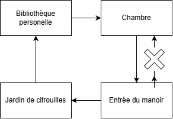

# Escape-Game
Escape room experiment for class

Le mystère de Halloween
 
Projet conçu en équipe avec : Joseph Karib, Simon Paquin
 
## Le public cible
 
- Pour qui : Les de groupes de 4 à 6 joueurs, âgées de 13 ans et plus, les familles ou groupes d'amis. 
- Ce qui est important pour eux : S’amuser, résoudre des énigmes en équipe, découvrir une ambiance mystérieuse et vivre une aventure immersive. Les joueurs ont besoin de consignes claires, d’indices si nécessaire, d’un prix abordable et d’un environnement sécuritaire.
 
## La conception
 
- L'intrigue : Le soir d’Halloween, une citrouille magique perd se fait voler sa chandelle. Les joueurs doivent explorer un vieux manoir, résoudre les énigmes laissées par son ancien propriétaire et ouvrir le coffre qui contient la chandelle de la citrouille afin de pouvoir retrouver son chemin hors du manoir avant la fin des 60 minutes.
- Le nombre d'énigmes : 6
- Le type d'énigmes : Déchiffrage d’une lettre mystérieuse, suite logique avec des citrouilles numérotées, recherche d’une clé dans une bibliothèque, association de symboles, message invisible révélé par une lampe UV et ouverture d’un coffrre final.
- Les besoins matériels : chandelle électrique, citrouilles en plastique, clés et cadenas, coffer/coffret
- Les besoins technologiques : speaker dans les salles, lampe/lumière UV, lumières d'ambiance (colorés)
- Les besoins humains : 1 personne vole la lumière de votre citrouille au début de l'escape room
- Le plan des salles (croquis) : 
 

 
## Les éléments importants
 
- Engagement sensoriel : ...

- Conception spatiale : Environnement sombre, creepy et sale, on voie qu'une personne était coincé une année complête
- Rétroaction : objet tombes lorsque certain puzzle sont réussis
- Technologie invisible : écriture visible seulement en UV qui va durer (pas partir après que quelqu'un met sa main dessus)
 
## Les risques et la sécurité
 
- Risque 1 : Être trop poche/enfantin (solution : Bien créer le décor pour qu'il soit sombre sans être trop dur de s'orienter)
- Risque 2 : ... (solution : ...)
 
## La promotion
 
- Stratégie 1 : Accessible à tous (pourquoi elle rejoint le public cible)
- Stratégie 2 : Voice acting à travers des speakers durant l'épreuve (pourquoi elle rejoint le public cible)
 
## Les ressources
 

 
- Son d'ambiance : [Fantasy ambience](https://www.youtube.com/watch?v=_uuM2t9CEAM)
- Crédits : 
    - « Titre de l'image », par Vladimir mulder, [Source](lien), [Licence](shutterstock)
    - « Fantasy Ambiance - Haunted Attic », Ambience Magic , [Source](lien), [Licence](youtube)
